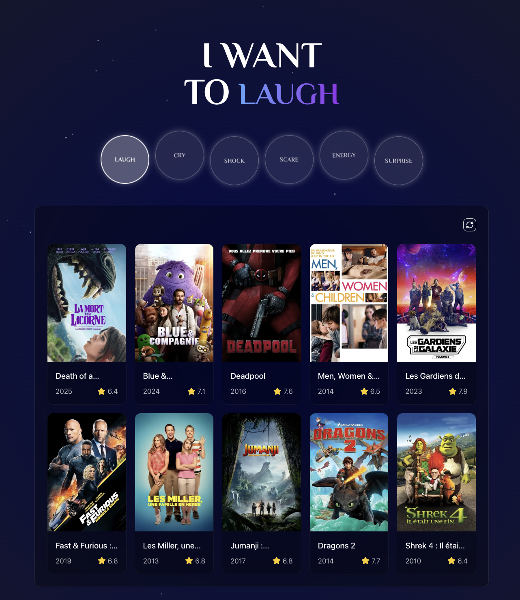

# 🎬 MoodMovie

MoodMovie helps you discover movies, TV shows, books and music that match your current mood. Pick an emotion, choose a format, and get a fresh selection every time.

Live: [moodmovie-by-aladin-akkari.vercel.app](https://moodmovie-by-aladin-akkari.vercel.app)



## 🌟 Features

- **Mood-based discovery** — 6 moods, each mapped to a genre per format (see below)
- **4 formats** — Movies, TV shows, Books and Music, switchable at any time
- **Where to watch** — streaming, rental and purchase providers for Canada and the United States
- **Book sources** — Google Books preview, Google Play Books and Amazon links
- **Music previews** — 30-second Deezer previews with a persistent mini-player
- **Favorites & watched list** — saved locally in the browser (`localStorage`), grouped by format
- **French interface** — accessible (keyboard, screen readers) and respects the system “reduce motion” setting
- **Infinite scroll** — randomized pages and sort orders so results change on every visit
- **SEO pages** — one static page per mood under `/mood/[slug]`, plus generated `sitemap.xml` and `robots.txt`

### Mood mapping

| Mood (UI) | Slug | Movies | TV shows | Books | Music |
|-----------|------|--------|----------|-------|-------|
| 😄 RIRE | `joie` | Comedy | Comedy | Humor | Pop dance |
| 😢 PLEURER | `tristesse` | Drama | Drama | Drama | Soul & blues |
| 🤢 CHOC | `choc` | Horror | Crime | Horror | Heavy metal |
| 😱 PEUR | `peur` | Thriller | Mystery | Thriller | Dark ambient |
| 😤 ÉNERGIE | `energie` | Action | Action & Adventure | Action | Hard rock |
| 😲 SURPRISE | `surprise` | Mystery | Sci-Fi & Fantasy | Mystery | Indie rock |

## 🛠️ Tech stack

- **Framework**: [Next.js 16](https://nextjs.org/) (App Router, React 19, TypeScript)
- **Styling**: [Tailwind CSS 3](https://tailwindcss.com/) with [shadcn/ui](https://ui.shadcn.com/) (Radix UI)
- **Data APIs**:
  - [The Movie Database (TMDB)](https://www.themoviedb.org/) — movies, TV shows, watch providers (API key required)
  - [Google Books](https://developers.google.com/books) — books (key optional, recommended)
  - [Deezer](https://developers.deezer.com/api) — music (no key required)
- **Analytics & hosting**: [Vercel](https://vercel.com/)

## 📁 Project structure

```
app/
  api/movies/            GET /api/movies?genreId&page&sort          → TMDB discover/movie
  api/movies/providers/  GET /api/movies/providers?movieId&mediaType → TMDB watch providers
  api/shows/             GET /api/shows?genreId&page&sort           → TMDB discover/tv
  api/books/             GET /api/books?subject&startIndex&orderBy  → Google Books
  api/music/             GET /api/music?genre&startIndex            → Deezer search
  mood/[slug]/           Static SEO page per mood
  page.tsx               Home page (mood picker + lists)
components/              Lists, modals, mini-player, UI primitives (components/ui)
context/                 Favorites, watched and music player providers
lib/                     localStorage helpers, site constants, class name util
types/                   Movie, Show, Book, Track
```

API keys never reach the browser: every external call goes through the `app/api` routes.

## 🚀 Getting started

### Prerequisites

- Node.js 20.9 or later
- [pnpm](https://pnpm.io/)
- A TMDB API key ([themoviedb.org/settings/api](https://www.themoviedb.org/settings/api))

### Installation

1. Clone the repository
   ```bash
   git clone https://github.com/aladinAK/moodmovie.git
   cd moodmovie
   ```

2. Install dependencies
   ```bash
   pnpm install
   ```

3. Create a `.env.local` file at the root of the project
   ```
   TMDB_API_KEY=your_api_key_here
   GOOGLE_BOOKS_API_KEY=your_api_key_here   # optional
   ```
   Without `TMDB_API_KEY`, the Movies and Shows tabs and the `/mood/[slug]` pages return no results. Music needs no key. Books work without a key, but anonymous requests share Google's daily quota and often fail with HTTP 429; a free key from the [Google Cloud console](https://console.cloud.google.com/apis/library/books.googleapis.com) avoids that.

4. Start the development server
   ```bash
   pnpm dev
   ```

5. Open [http://localhost:3000](http://localhost:3000)

### Scripts

| Command | Description |
|---------|-------------|
| `pnpm dev` | Development server (Turbopack) |
| `pnpm build` | Production build |
| `pnpm start` | Serve the production build |
| `pnpm lint` | ESLint |
| `pnpm exec tsc --noEmit` | Type check |

## 🌐 Deployment

The app deploys on Vercel:
1. Import this repository in Vercel
2. Set the `TMDB_API_KEY` environment variable (and optionally `GOOGLE_BOOKS_API_KEY`)
3. Deploy

If the production domain changes, update `BASE_URL` in `lib/site.ts` (used by metadata, sitemap and robots).

## 🤝 Contributions

Contributions are welcome! Feel free to open an issue or submit a pull request.

## 📝 License

This project is licensed under the MIT License - see the [LICENSE](LICENSE) file for details.

## 🙏 Credits

- Developed by [Aladin Akkari](https://aladinakkari.ca)
- This product uses the TMDB API but is not endorsed or certified by TMDB.
- [TMDB Logo](https://www.themoviedb.org/about/logos-attribution)
